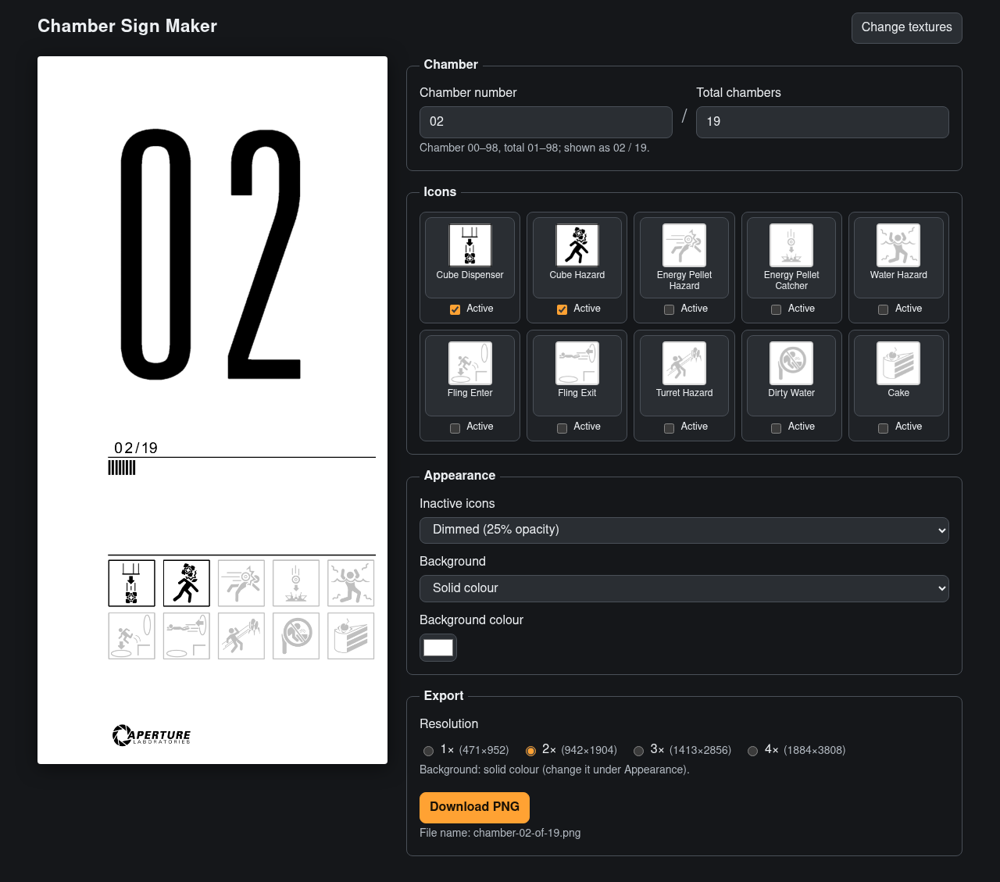

# Chamber Sign Maker

Design and export **Portal (2007)-style test chamber signs**: the
illuminated light-board panels at the entrance of each test chamber. Set the
chamber number and total, choose which of the 10 hazard/feature icons are
shown and lit, and download the result as a high-resolution PNG.

All artwork is drawn from the game's own sign texture, which **you supply
from your own copy of Portal**. This repository contains no game assets,
only the coordinates of each element inside the texture.



> _Screenshot placeholder: add `docs/screenshot.png`. Because the sign is
> rendered from Valve's artwork, think twice before committing a screenshot
> of it._

## Features

- Chamber number and total (`04 / 19`) as number inputs, validated
  (chamber 00–98, total 01–98, chamber ≤ total) and zero-padded to two
  digits.
- Ten icon slots (two rows of five). Each holds any icon, or nothing, and can
  be switched between **active** (lit) and **inactive** (dimmed to 25%
  opacity, or optionally drawn with the game's own unlit texture).
- Keyboard-accessible icon picker: thumbnails cropped from the texture, plus
  each icon's name and description.
- Live canvas preview. The PNG export uses the same rendering code at 1×–4×,
  with a solid or transparent background, saved as e.g.
  `chamber-04-of-19.png`.
- State is saved to `localStorage` and the URL hash, so a link reproduces a
  sign exactly.
- Fully static, client-side only. Textures are never uploaded.

## Getting started

Requires Node.js 20.19+ (or 22.12+) and **npm** (the only supported package
manager; `package-lock.json` is committed).

```sh
npm install
npm run dev
```

Put `awe_total.png` (and optionally `awe_total_grey.png`) in `assets/` or in
the project root first (see [Obtaining the textures](#obtaining-the-textures)).
Without them the app opens a setup screen where you can pick the files
instead.

### Scripts

| Script              | What it does                                               |
| ------------------- | ---------------------------------------------------------- |
| `npm run dev`       | Vite dev server; serves your textures from the working dir |
| `npm run build`     | Type-check and build the static site into `dist/`          |
| `npm run preview`   | Serve `dist/` locally under the GitHub Pages base path     |
| `npm run lint`      | Lint with [oxlint](https://oxc.rs) (`.oxlintrc.json`)      |
| `npm run format`    | Format everything with Prettier (`format:check` to verify) |
| `npm run typecheck` | `tsc -b` in strict mode, no emit                           |
| `npm test`          | Run the Vitest + Testing Library suite once (`test:watch`) |

Linting follows the current official Vite `react-ts` template, which ships
oxlint rather than ESLint.

## Why React?

React and Svelte would both suit an app this size. React won because
[Testing Library](https://testing-library.com/docs/react-testing-library/intro/)
support is first-class, and because the interactive parts (the modal
listbox, its focus management, the draft-vs-committed number fields) are
easy to express as small typed components and hooks. The sign itself is a
canvas, so the framework only drives the controls.

## Project structure

```
.github/workflows/
  ci.yml               lint, format check, typecheck, tests, build
  pages.yml            build + deploy to GitHub Pages (actions/deploy-pages)
src/
  atlas.ts             texture coordinates of every icon and glyph (typed)
  iconDescriptions.ts  icon id -> description shown in the picker
  state.ts             sign state, validation, reducer, URL-hash (de)serialization
  persistence.ts       localStorage + URL hash sync
  settings.ts          per-browser display/export preferences
  export.ts            offscreen render -> PNG blob -> download
  render/
    drawRegion.ts      draws one (possibly rotated) atlas region
    layout.ts          pure: sign state -> positioned draw operations
    paint.ts           paints a layout onto a canvas (preview AND export)
  textures/
    types.ts           texture file names and types
    decode.ts          decode + sanity-check a user-supplied PNG
    cache.ts           optional IndexedDB cache of the texture files
    load.ts            dev-server / cache auto-loading
  components/          Editor, SetupScreen, ChamberFields, IconSlot,
                       IconPicker, SignPreview, ExportPanel, AtlasCrop
  test/                Vitest setup, canvas/texture mocks
vite.config.ts         base path for Pages + dev-only texture middleware
```

## Obtaining the textures

The sign artwork lives in `portal_pak_dir.vpk` in your Portal installation
(usually `Steam/steamapps/common/Portal/portal/`). You need a legally
obtained copy of the game.

1. Open `portal_pak_dir.vpk` with a VPK browser such as
   [VPKEdit](https://github.com/craftablescience/VPKEdit) or GCFScape.
2. Extract `materials/models/props_animsigns/awe_total.vtf` and
   `materials/models/props_animsigns/awe_total_grey.vtf`.
3. Convert both to PNG **keeping the alpha channel**, e.g. with VTFEdit
   (_File → Export_) or the `no_vtf` command-line tool, naming them
   `awe_total.png` and `awe_total_grey.png`.

Then either:

- **Local development:** put them in `assets/` (or the repo root). The Vite
  dev server exposes them at `/__game-textures/…` through a small
  development-only middleware. They are never copied into `public/` or
  `src/`, and the middleware doesn't exist in production builds.
- **Deployed site:** pick them on the setup screen. They are decoded in
  the browser and, if you tick the box, cached in IndexedDB so you don't
  need to pick them again. Use **Change textures** to replace them.

The textures are git-ignored (`awe_total*.png`, `*.vtf`, `*.vpk`), and both
workflows fail if any end up in `dist/`.

### How the two textures differ

Measured from the files:

|                 | `awe_total.png`   | `awe_total_grey.png` |
| --------------- | ----------------- | -------------------- |
| Size / format   | 2048×1024 RGBA    | 2048×1024 RGBA       |
| Colour channels | all black (0,0,0) | all black (0,0,0)    |
| Alpha range     | 0–255             | 0–38                 |
| Layout          | identical         | identical            |

Both are black artwork whose shape lives entirely in the alpha channel. The
grey file is the same artwork with alpha scaled to ≈14% (36/255) of the lit
version: the game's **unlit** state, as an unpowered panel shows it. Small
per-pixel differences (mean ≈0.6/255) come from separate texture
compression. That means:

- `awe_total.png` is required. It provides every lit element, and the
  inactive look via 25% opacity.
- `awe_total_grey.png` is optional. Under _Appearance → Inactive icons_ you
  can draw inactive icons and future progress ticks with the game's own
  unlit texture (≈14%) instead of 25% opacity.

Since the artwork is black on transparent, signs are drawn over a light
background (white by default). Choose _Transparent_ to export just the
artwork.

## How the atlas metadata works

`src/atlas.ts` maps every element to a rectangle `{ x, y, width, height,
rotation }` in the native 2048×1024 texture space:

| Entry          | Contents                                                     |
| -------------- | ------------------------------------------------------------ |
| `icons`        | 10 icons, 333 px squares including their frame               |
| `bigDigits`    | 0–9 for the large chamber number (~415 px tall)              |
| `smallDigits`  | 0–9 for the `04/19` counter (~74 px tall, right-hand column) |
| `slash`        | the `/`, taken from the pre-printed `/19`                    |
| `progressTick` | one of the four identical vertical bars                      |
| `logo`         | the Aperture Laboratories logo                               |

The rectangles came from a connected-component pass over the alpha channel,
padded by 2 px so anti-aliased edges survive. Notes:

- Some elements are packed **sideways**. The big `0` is the horizontal
  "pill" under `123`, and the logo runs vertically along the right edge.
  `rotation` (clockwise degrees: `0`, `90` or `-90`) tells the renderer how
  to draw them upright, and `width`/`height` describe the region as stored.
- The big `1` starts at x=1488 instead of 1484, because the sideways `0`
  reaches into the columns left of the `1`'s flag.
- A texture with the same 2:1 aspect ratio at another resolution (e.g. a
  smaller mip) still works, because rectangles scale with the texture
  width.

Every surface (preview, picker thumbnails, export) crops from the loaded
texture with `drawRegion()`. The sign itself goes through
`layoutSign()` (state → draw ops) and `paintSign()` (draw ops → canvas),
so the preview and the PNG export always match.

## Adding icons and descriptions

1. Add the id to `ICON_IDS` in `src/atlas.ts`, plus a display name in
   `iconNames` and a rectangle in `atlas.icons`.
2. Add a description in `src/iconDescriptions.ts`. Both maps are typed
   `Record<IconId, …>`, so TypeScript reports any missing entry.
3. Run `npm test`. The atlas tests check every rectangle lies inside the
   texture and that icons don't overlap.

The descriptions are placeholders for now. Replace the strings in
`iconDescriptions.ts`; no other code changes are needed. Slot count is
`SLOT_COUNT` in `src/state.ts`, and grid columns are `ICON_COLUMNS` in
`src/render/layout.ts`.

## Deployment (GitHub Pages)

1. Push to GitHub and, under **Settings → Pages**, set _Source_ to
   **GitHub Actions**.
2. Every push to `main` runs `.github/workflows/pages.yml`: `npm ci`,
   tests, build, a check that no textures are in `dist/`, then
   `actions/upload-pages-artifact` and `actions/deploy-pages`.

Vite's `base` is set to `/<repo-name>/`. In Actions the name is read from
`GITHUB_REPOSITORY`; locally it defaults to `/chamber-sign-maker/`. Set
`VITE_BASE=/` for a user/organisation site or a custom domain. Visitors
supply their own textures through the setup screen.

CI (`.github/workflows/ci.yml`) runs on every push and pull request:
`npm ci` (with npm cache), lint, format check, typecheck, tests and build.
Tests mock the canvas and textures, so CI never needs the game files.

## Assumptions

- **Sign layout.** The texture contains the parts but not their arrangement.
  The layout is a recreation: big number on top, then the `NN/MM` counter
  with one progress tick per chamber (lit up to the current one), then the
  icons in **two rows of five**, then the logo. Proportions live in
  `src/render/layout.ts`.
- **Icon order and names** follow the community names for the ten
  Portal 1 icons. The texture packs them as 4 + 3 + 3; slots default to the
  in-game order (cube dispenser … cake).
- **Number range:** the chamber number may be `00` (Portal's first
  chamber) up to `98`; the total must be `01`–`98`. Limits are
  `MIN_CHAMBER`, `MIN_TOTAL` and `MAX_CHAMBER` in `src/state.ts`.

## License

The source code is released under the [MIT License](LICENSE).

**Fan project.** Not affiliated with, endorsed by or sponsored by Valve
Corporation. _Portal_, _Aperture Laboratories_ and related names and
artwork are trademarks and/or copyright of Valve Corporation. **No game
assets are included** in this repository or in the deployed site: the
textures are loaded at runtime from your own legally obtained copy of the
game and stay on your device.
